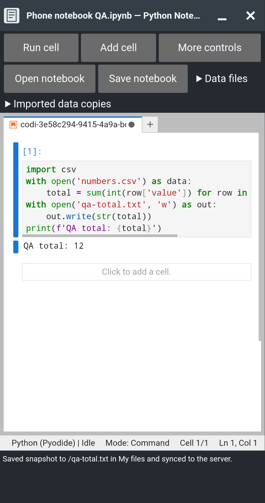

# Python Notebook phone workflow

Samsung Galaxy S10+ with Chrome 158.0.8127.92, 411 CSS-pixel portrait viewport. This check used a disposable account and a WebOS preview built with Notebook source `307578906db54f726525333186c0690dc99bd8ed`.

1. Open Python Notebook from Programming and run the sample with **Run cell**. Pyodide returns `Mean: 12.10`.
2. Press **Save notebook**. The standard name is `Notebook.ipynb`. Type `Phone notebook QA` and confirm.
3. Close the app. In My files, open `Phone notebook QA.ipynb`. Python Notebook launches and the original cell remains editable.
4. Import a CSV containing 7 and 5 through **Data files**. Run the cell that totals the values. It prints `QA total: 12`.
5. Save the Python-generated text through **Save Python output**. The account file contains exactly `12`.

